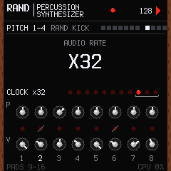
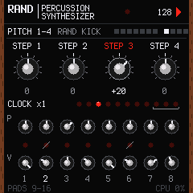

# RAND

A raw percussion synth for the M-VAVE FM-1 by **swtdr34mz**, in the spirit of the Behringer EDGE and the Moog DFAM.
Moog-Eurorack look on the screen: black panel, wooden cheeks, knobs with silver caps, red step LEDs.
One voice, an 8-step sequencer with two rows, and a clock you can turn up until the rhythm becomes a tone.
Built on [fm1-base](https://github.com/charlesvestal/fm1-base) and [felucca-bsp](https://github.com/hugelton/felucca-bsp).

  

## The voice

Two oscillators (triangle or pulse, 8 Hz to 8 kHz without octave switches), FM from VCO 1 to VCO 2, hard sync,
white-to-pink noise, a 24 dB ladder filter (low or high pass) with resonance, a pitch, a filter and an amp envelope,
velocity to amp and filter, drive.

## The sequencer

Eight steps, each with a **pitch** and a **velocity** and on or off; length 1 to 8. The **CLOCK** runs from /4 to x128
of the tempo's sixteenths: from x32 on the steps come so fast that you hear them as a tone, and the two rows shape
its waveform. RAND follows **MIDI clock and START / STOP / CONTINUE** over USB (for example from SIX MACHINES); MIDI
notes play the voice.

## Pages

Laid out like the EDGE's panel, left to right.

| Button | Page | K1 | K2 | K3 | K4 |
| --- | --- | --- | --- | --- | --- |
| HOME | **OSC 1** | FREQUENCY | ENVELOPE | SEQ PITCH | LEVEL |
| SEL | **OSC 2** | FREQUENCY | ENVELOPE | SEQ PITCH | LEVEL |
| ENV | **EG / FM / NOISE** | EG DECAY (both VCOs) | 1-2 FM | NOISE | COLOR |
| LFO | **FILTER** | CUTOFF | RESONANCE | DECAY | ENVELOPE |
| EDIT | **OUTPUT** | VCA MODE (fast / slow) | DECAY | VOLUME | DRIVE |
| FX | **MOD** | NOISE/VCF | VEL>VCF | VEL>AMP | LENGTH |
| GLO | **SWITCHES** | SHAPE 1 | SHAPE 2 | HARD SYNC | VCF MODE (LP / HP) |
| SEQ | **PITCH 1-4, PITCH 5-8, VEL 1-4, VEL 5-8** | the four steps' values | | | |

The same button again goes back to OSC 1; SEQ steps through its four pages.

## Controls

| Control | What it does |
| --- | --- |
| White keys 1-8 | The steps: a tap turns a step on or off; held, K1 its pitch, K2 its velocity |
| White keys 9-16 | Pads: play steps 1-8 by hand |
| Black keys 1-5, held | The clock jumps to x2, x4, x8, x32, x128 at once; let go, it comes back |
| SELECT | Tempo (40 to 280 BPM) |
| ALGORITHM | CLOCK: /4, /2, x1 ... x128 |
| PRESET | The eight presets (sound and pattern) |
| OCT- / OCT+ | Length |
| ARP | RAND: new random pitch and velocity rows |
| PLAY | Start / stop |
| REC held 1 s | The preset back as it was |

Presets: RAND KICK, EBM BASS, METAL HATS, IRON TOMS, CRACK, ZAP, AUDIO RATE, BREAKCORE.
Settings save themselves once the sequencer stops.

## The sound core

`dsp/` is plain C with no tie to the FM-1, so the same files can go into a VST3 plugin. To hear it on a computer:

    cc -O2 -Idsp dsp/rand_core.c tools/render_demo.c -lm -o render_demo && ./render_demo .

## Building

    git clone --recursive https://github.com/swtdr34mz-afk/RAND
    X0X_FONTSET=terminus python3 fm1-base/tools/build.py . --host
    build/host/rand_host tests/basic.txt build/host

GitHub Actions builds the installable `.fwsc` on every push (Actions tab > the run > Artifacts). A tag `v0.1.0` makes a
release with it.

## Licence

MPL-2.0. See [CREDITS.md](CREDITS.md).
