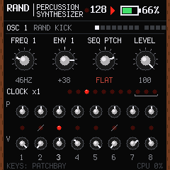
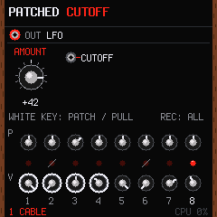

# RAND

A raw percussion synth for the M-VAVE FM-1 by **swtdr34mz**, in the spirit of the Behringer EDGE and the Moog DFAM.
Moog-Eurorack look on the screen: black panel, wooden cheeks, knobs with silver caps, red step LEDs.
One voice, an 8-step sequencer with two rows, and a clock you can turn up until the rhythm becomes a tone.
Built on [fm1-base](https://github.com/charlesvestal/fm1-base) and [felucca-bsp](https://github.com/hugelton/felucca-bsp).

  

## The voice

Two oscillators (triangle or pulse, 8 Hz to 8 kHz without octave switches), 1-2 FM (VCO 1 into VCO 2, and half as much
back from VCO 2 into VCO 1, so it works even with VCO 2 muted), hard sync,
white or pink noise, a pitch, a filter and an amp envelope, velocity to amp and filter, drive; then a ping-pong delay
in tempo whose echoes darken like tape, a reverb and a master filter.

The filter is a model of the **Moog transistor ladder** (after Antti Huovilainen): four stages, each saturating on
its own, the feedback taken half a sample late as in the circuit. The mixer drives it as on the original: mixed loud,
it saturates warm. It tracks: turned up to self-oscillation it plays the cutoff's note within about a cent from
110 Hz to 3.5 kHz. Oscillators, mixer and filter run at twice the sample rate and come back through a 23-tap
half-band filter, so high notes and FM stay clean. Each VCO drifts a few cents on its own, as analog ones do.

If the FM-1 ever runs short of time (the load over 88 % for a second), RAND drops the oversampling by itself and shows
**ECO** next to the CPU load, before there could be dropouts.

## The battery

The battery is always on screen, top right: a clear symbol filled green, amber under 40 %, red under 15 % (it blinks
under 10 %), with the percentage beside it. On a USB cable a lightning bolt shows the cell charging, and `USB` when it
is full. The percentage comes from the cell's voltage along a lithium-ion discharge curve: an estimate, not yet
calibrated on an FM-1.

## The sequencer

Eight steps, each with a **pitch** and a **velocity** knob, length 1 to 8. The **CLOCK** runs from /4 to x128 of the
tempo's sixteenths: from x32 on the steps come so fast that you hear them as a tone, and the two rows shape its
waveform. RAND follows **MIDI clock and START / STOP / CONTINUE** over USB (for example from SIX MACHINES); MIDI notes
play the voice.

## Pages

Laid out like the EDGE's panel.

| Button | Page | K1 | K2 | K3 | K4 |
| --- | --- | --- | --- | --- | --- |
| HOME | **OSC 1** (HOME again: **OSC 2**) | FREQUENCY | ENVELOPE | SEQ PITCH | LEVEL |
| SEL | **FM / NOISE** | 1-2 FM | NOISE | NOISE/VCF | VEL>VCF |
| ENV | **ENVELOPES** | VCO DECAY (both VCOs) | VCF DECAY | VCA DECAY | VCA MODE (fast / slow) |
| LFO | **FILTER** | CUTOFF | RESONANCE | ENVELOPE | VCF MODE (LP / HP) |
| EDIT | **OUTPUT** | VEL>AMP | VOLUME | LENGTH | DELAY TIME (1/32 .. 3/8) |
| FX | **FX** | REVERB | DELAY (ping-pong, in tempo) | DRIVE | MASTER FILTER (LP <- off -> HP) |
| GLO | **SWITCHES** | SHAPE 1 | SHAPE 2 | HARD SYNC | NOISE COLOR (white / pink) |
| SEQ | **PITCH 1-4, PITCH 5-8, VEL 1-4, VEL 5-8** | one knob per step, as on the DFAM | | | |

The steps under the knobs get a white ring. A velocity of 0 silences a step.

A knob that has nothing to act on right now says why in red under it, for example `LVL2=0` on the OSC 2 page while
VCO 2 is muted, `DLY=0` for the delay time while the delay is off, or `FLAT` for SEQ PITCH while all eight pitch knobs
stand alike.

## The patchbay on the keys

The keys are the patch points: the **11 black keys are outputs**, the **16 white keys are inputs**. Hold a black key
and tap a white one: a cable (tap again: pulled). While a black key is held, K1 sets how strongly its cables pull
(minus to plus) and REC pulls all of them. A white key alone shows what goes into it. Up to 8 cables; they are saved
with the sound, and the presets bring some.

| Black key (OUT) | | White key (IN) | |
| --- | --- | --- | --- |
| 1 VCO 1 | 7 VELOCITY | 1 VCO 1 FREQ | 9 VCA (audio in: ring mod) |
| 2 VCO 2 | 8 PITCH ROW | 2 VCO 2 FREQ | 10 DRIVE |
| 3 NOISE | 9 LFO (one bar) | 3 1-2 FM | 11 DECAY |
| 4 PITCH EG | 10 RANDOM (new each hit) | 4 VCO 1 LEVEL | 12 TEMPO |
| 5 VCF EG | 11 TRIGGER (a short pulse) | 5 VCO 2 LEVEL | 13 DELAY |
| 6 VCA EG | | 6 NOISE LEVEL | 14 REVERB |
| | | 7 CUTOFF | 15 MASTER FILTER |
| | | 8 RESONANCE | 16 CRUSH (bits and rate) |

## Controls

| Control | What it does |
| --- | --- |
| SELECT | Tempo (40 to 280 BPM) |
| ALGORITHM | CLOCK: /4, /2, x1 ... x128 (from x32 on the rhythm becomes a tone) |
| PRESET | The eight presets (sound, pattern, cables) |
| OCT- / OCT+ | Length |
| SAVE | TRIGGER: one hit |
| ARP | RAND: new random pitch and velocity rows |
| PLAY | Start / stop |
| REC held 1 s | The preset back as it was |

Presets: RAND KICK, EBM BASS, METAL HATS, IRON TOMS, CRACK, ZAP, AUDIO RATE, BREAKCORE.
Settings save themselves once the sequencer stops.

## The sound core

`dsp/` is plain C with no tie to the FM-1, so the same files can go into a VST3 plugin. To hear it on a computer:

    cc -O2 -Idsp dsp/rand_core.c tools/render_demo.c -lm -o render_demo && ./render_demo .

`tools/knobcheck.c` turns every knob in every preset from one end to the other and measures what changes.
`tools/measure.c` checks it: the filter's tuning when it self-oscillates, the oscillators' aliasing, the time it takes.

## Building

    git clone --recursive https://github.com/swtdr34mz-afk/RAND
    X0X_FONTSET=terminus python3 fm1-base/tools/build.py . --host
    build/host/rand_host tests/basic.txt build/host

GitHub Actions builds the installable `.fwsc` on every push (Actions tab > the run > Artifacts). A tag `v0.1.0` makes a
release with it.

## Licence

MPL-2.0. See [CREDITS.md](CREDITS.md).
